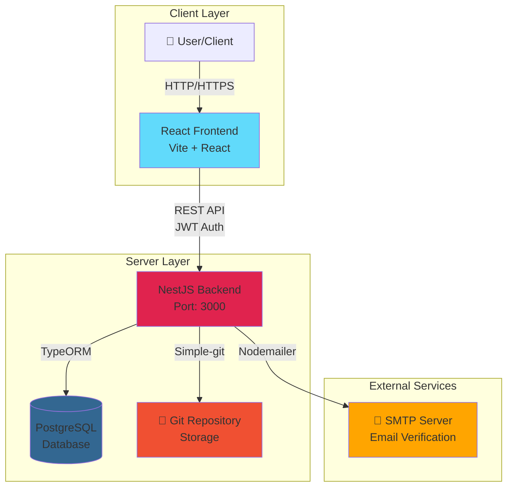
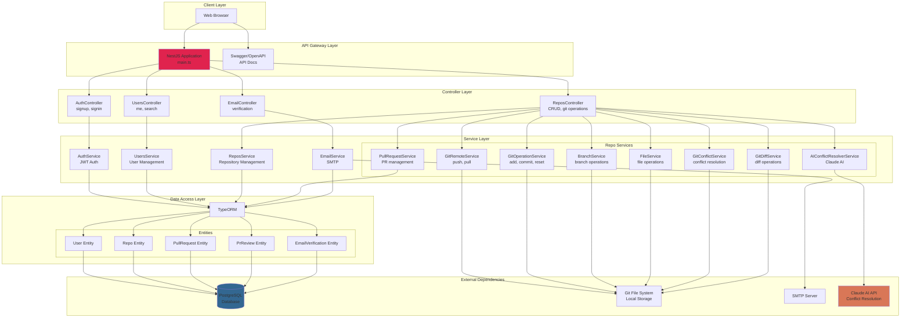
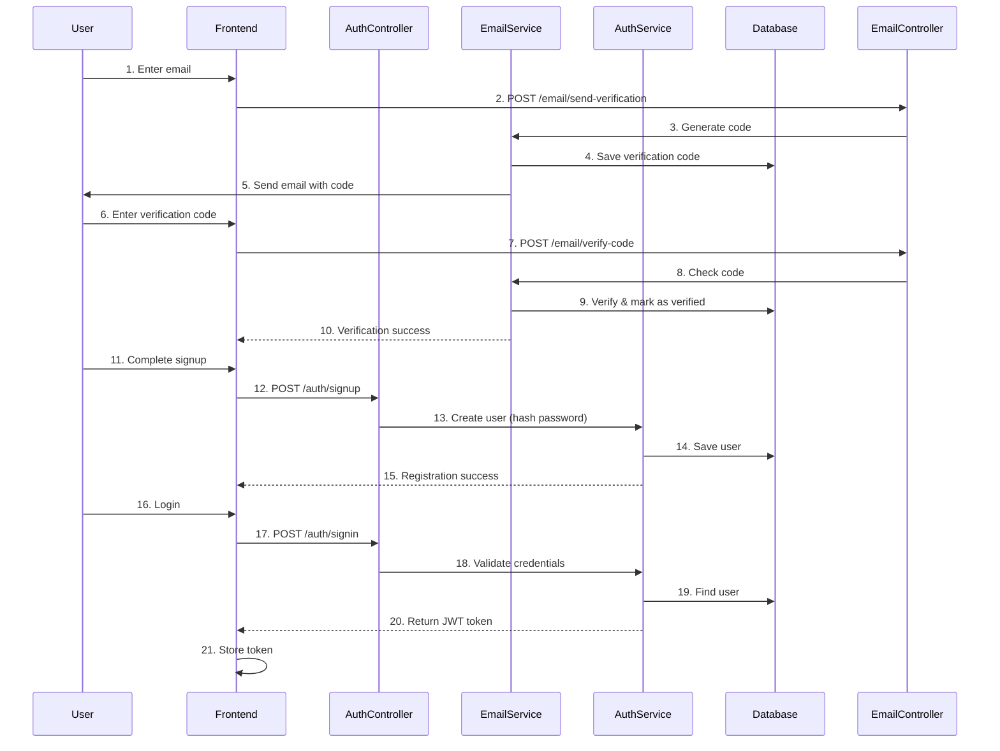
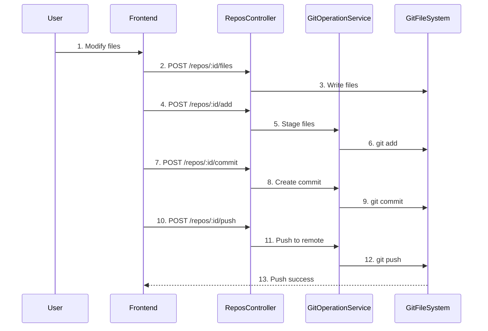
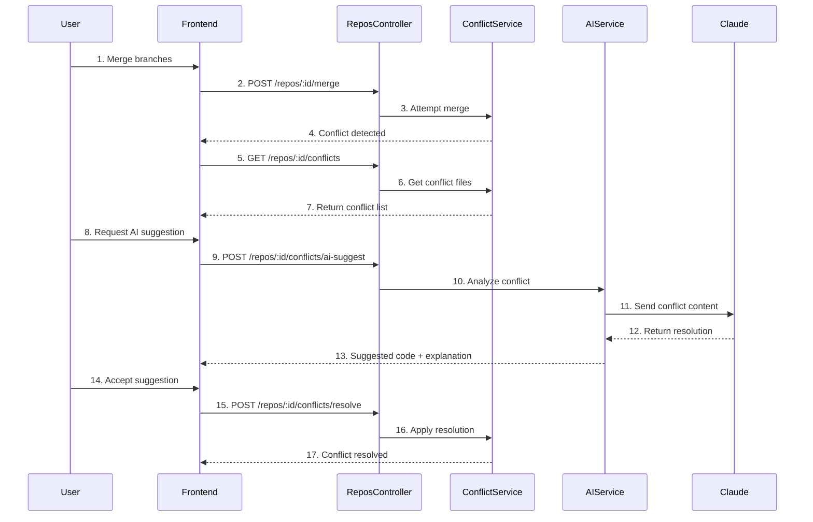

# Git Project

<div align="center">

[](https://nestjs.com/)
[](https://www.typescriptlang.org/)
[](https://www.postgresql.org/)
[](https://bun.sh/)

A modern Git repository management system built with NestJS, featuring user authentication, email verification, and repository operations.

</div>

---

## 📋 Table of Contents

- [Features](#-features)
- [Tech Stack](#-tech-stack)
- [Prerequisites](#-prerequisites)
- [Installation](#-installation)
- [Configuration](#-configuration)
- [Running the Application](#-running-the-application)
- [API Documentation](#-api-documentation)
- [Testing](#-testing)
- [Project Structure](#-project-structure)
- [License](#-license)

---

## ✨ Features

- **User Authentication & Authorization**
  - JWT-based authentication
  - Secure password hashing with bcrypt
  - Email verification system

- **Repository Management**
  - Git repository operations using simple-git
  - Repository creation and management
  - File upload support with multer

- **Email Service**
  - Email verification codes
  - Nodemailer integration

- **API Documentation**
  - Swagger/OpenAPI integration
  - Interactive API documentation

---

## 🏗 System Architecture

> 💡 **Interactive Diagrams Available!**
> - **Simple Version**: [`docs/architecture-simple.drawio`](./docs/architecture-simple.drawio) - Clean overview (recommended for presentations)
> - **Detailed Version**: [`docs/system-architecture.drawio`](./docs/system-architecture.drawio) - Full architecture with all layers
>
> Open these files in [draw.io](https://app.diagrams.net/) to view and edit beautiful, interactive diagrams!

### High-Level Overview



### Key Components

- **Frontend (React)**: User interface built with React and Vite
- **Backend (NestJS)**: RESTful API server with JWT authentication
- **Database (PostgreSQL)**: Stores user data, repositories, and metadata
- **Email Service**: Sends verification codes via SMTP
- **Git Storage**: Manages repository files using simple-git

### Detailed Architecture



### Authentication Flow



### Git Operations Flow



### AI Conflict Resolution Flow



---

## 🛠 Tech Stack

### Core Framework
- **[NestJS](https://nestjs.com/)** - Progressive Node.js framework
- **[TypeScript](https://www.typescriptlang.org/)** - Type-safe JavaScript

### Database & ORM
- **[PostgreSQL](https://www.postgresql.org/)** - Relational database
- **[TypeORM](https://typeorm.io/)** - TypeScript ORM

### Authentication
- **[Passport](http://www.passportjs.org/)** - Authentication middleware
- **[JWT](https://jwt.io/)** - JSON Web Tokens
- **[bcrypt](https://github.com/kelektiv/node.bcrypt.js)** - Password hashing

### Tools & Utilities
- **[Simple Git](https://github.com/steveukx/git-js)** - Git operations
- **[Nodemailer](https://nodemailer.com/)** - Email sending
- **[Multer](https://github.com/expressjs/multer)** - File uploads
- **[Swagger](https://swagger.io/)** - API documentation
- **[Bun](https://bun.sh/)** - Fast JavaScript runtime & package manager

---

## 📦 Prerequisites

Before you begin, ensure you have the following installed:

- **Bun** >= 1.0.0 ([Installation guide](https://bun.sh/docs/installation))
- **Node.js** >= 18.0.0
- **PostgreSQL** >= 14.0

---

## 🚀 Installation

1. **Clone the repository**
   ```bash
   git clone <repository-url>
   cd git-project
   ```

2. **Install dependencies**
   ```bash
   bun install
   ```

---

## ⚙️ Configuration

1. **Create environment file**
   ```bash
   cp .env.example .env
   ```

2. **Configure environment variables**
   ```env
   # Database
   DB_HOST=localhost
   DB_PORT=5432
   DB_USERNAME=your_username
   DB_PASSWORD=your_password
   DB_DATABASE=your_database

   # JWT
   JWT_SECRET=your_jwt_secret
   JWT_EXPIRATION=3600

   # Email
   SMTP_HOST=smtp.example.com
   SMTP_PORT=587
   SMTP_USER=your_email
   SMTP_PASS=your_password
   ```

---

## 🏃 Running the Application

### Development Mode
```bash
bun run start:dev
```

### Production Mode
```bash
# Build the application
bun run build

# Start production server
bun run start:prod
```

### Debug Mode
```bash
bun run start:debug
```

The application will be available at `http://localhost:3000`

---

## 📚 API Documentation

Once the application is running, access the interactive API documentation:

- **Swagger UI**: `http://localhost:3000/api`

---

## 📁 Project Structure

계층형 구조이며, 의존 방향은 `presentation → application → infrastructure / domain` 입니다.

```
src/
├── domain/            # Effect Schema 도메인 모델, 요청/응답 스키마, 순수 함수 (경로·ref 검증, diff 파서, 커밋 그래프)
├── application/       # 유스케이스 서비스 (Effect 반환). 권한 확인은 RepoWorkspaceService
├── infrastructure/    # TypeORM 엔티티/리포지토리, git·파일시스템·메일·Claude 클라이언트
├── presentation/      # 컨트롤러와 Nest 모듈. BaseController.runEffect/decode, Swagger(apiSchema)
├── common/            # 태그드 에러(Data.TaggedError), Effect 헬퍼
├── app.config.ts      # 환경변수 스키마
└── main.ts
```

- 요청 검증: 컨트롤러에서 `this.decode(Schema, body)` — 실패 시 필드별 메시지와 함께 400
- 에러 → HTTP 상태: `presentation/base.controller.ts`의 `STATUS_BY_TAG`
- Swagger 스키마는 도메인 스키마에서 `apiSchema()`로 생성

---

## 🛠 Development Tools

```bash
bun run lint        # Biome (lint + format 검사)
bun run lint:fix    # Biome 자동 수정
bun run tsc         # 타입 체크
bun run test        # Vitest (실제 git을 쓰는 통합 테스트 포함)
bun run check:di    # DB 없이 전체 Nest DI 그래프 조립 확인
bun run build
bun run eval:ai     # AI 충돌 해결 평가 (CLAUDE_API_KEY 필요, CLAUDE_MODEL로 모델 고정 가능)
```

> Vitest는 decorator metadata를 내보내지 않으므로, DI 관련 변경(특히 주입받는 클래스의 `import type`) 후에는 `check:di`를 실행하세요.

---

## 📝 License

This project is [UNLICENSED](LICENSE).

---

## 🤝 Contributing

Contributions, issues, and feature requests are welcome!

